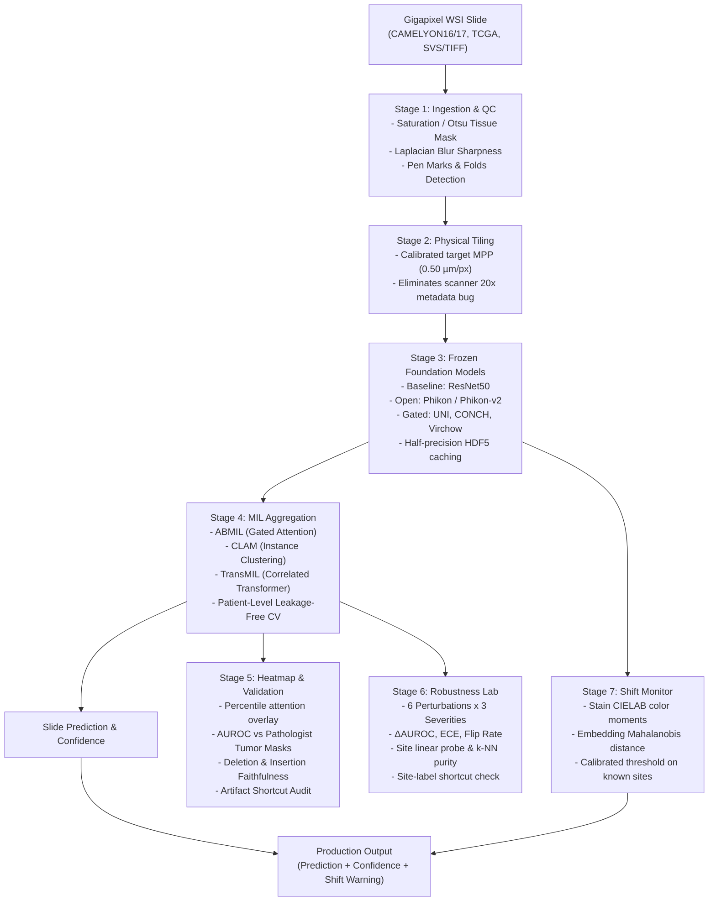

# SlideShift 🔬

[](https://www.python.org/)
[](https://opensource.org/licenses/Apache-2.0)
[](https://pytorch.org/)
[](https://github.com/DjebrilSVN/SlideShift)
[](https://github.com/psf/black)

> **A whole-slide pathology pipeline that turns frozen foundation models and multiple-instance learning into robust slide-level classifiers. Explains itself with attention heatmaps validated against pathologist annotations, benchmarks failure modes across scanner, stain, and hospital shifts, and guards deployments with a real-time shift monitor.**

---

## 💡 Thesis & The Portfolio Hook

Pathology whole-slide images (WSIs) are gigapixel files ($50,000 \times 50,000$ pixels or more). Pathologists label slides as a whole (*"metastatic adenocarcinoma"*), but rarely delineate every cell. Multiple-Instance Learning (MIL) solves this weak supervision challenge by treating each slide as a bag of 5,000–50,000 tiles. Frozen foundation models (such as **UNI**, **CONCH**, **Virchow**, and **Phikon**) convert each tile into expressive embeddings.

**The portfolio hook:** Most published projects report a single accuracy number on a single clean dataset. Real clinical deployments fail because a laboratory purchases a new scanner, changes hematoxylin formulations, or handles slides from referral hospitals.

**SlideShift answers:**
1. *Do foundation models actually make slide classifiers immune to scanner, stain, and site shifts?* (Spoiler: Foundation models degrade less than ImageNet baselines, but none are immune).
2. *Can attention heatmaps be trusted, or do models latch onto pen marks and tissue folds?*
3. *Which mitigations (stain normalization, feature standardization, DANN) actually help?*
4. *Can we build a lightweight real-time **Shift Monitor** that flags out-of-distribution slides before erroneous clinical predictions occur?*

---

## 🏗️ Architecture



---

## ✨ Key Capabilities

### 1. Slide Ingestion & Quality Control
- **Physical-size Tiling:** Tiles by calibrated physical resolution (e.g., $0.50\ \mu\text{m/px}$ for $\approx 20\times$), rather than trusting nominal magnification metadata. This prevents a classic bug where scanner resolution mismatch creates an artificial domain shift.
- **Automated Artifact Flags:** Quantifies blur score (Laplacian variance), tissue fold fraction, felt pen marker ink, and air bubbles.

### 2. Foundation Model Comparison Matrix
Compare five distinct model families using half-precision streaming:
- **Baseline:** ImageNet-pretrained ResNet-50 / ViT
- **Open Weights:** Phikon / Phikon-v2 (Owkin iBOT ViT-B, 768-dim)
- **Gated Benchmarks:** UNI / UNI2 (Mahmood Lab, 1024-dim), CONCH (Vision-Language, 512-dim), Virchow / Virchow2 (Paige AI / MSKCC, 1280-dim)
- **Deterministic Mock Encoder:** Instant offline testing and CI without GPU dependencies.

### 3. Multiple-Instance Learning Aggregators
- **Mean & Max Pooling Baselines**
- **Attention-based MIL (ABMIL):** Gated dual-stream attention scoring (Ilse et al.).
- **CLAM (CLAM-SB & CLAM-MB):** Clustering-constrained instance supervision (Lu et al., *Nature BME*).
- **TransMIL:** Transformer modeling tile-to-tile morphological correlations (Shao et al., *NeurIPS*).
- **DTFD-MIL:** Double-Tier Feature Distillation via Bernoulli pseudo-bag sampling and tier-2 distillation loss (Zhang et al., *CVPR 2022*).
- **ACMIL:** Adaptation-Centered Multi-Branch MIL with adaptive context gating and branch orthogonality regularization (Yang et al., *NeurIPS 2023*).
- **Patch-GCN:** Spatial Graph Convolutional Network operating on tile $k$-NN spatial graphs (Chen et al., *MICCAI / NeurIPS 2021*).
- **Leakage Prevention:** Grouped Stratified K-Fold by patient ID (ensuring multi-slide patients never leak across splits).
- **Advanced Training Loop:** Feature Mixup, Cosine Annealing with Warm Restarts, Label Smoothing, Gradient Clipping, DeLong test for AUC pairwise comparison, and Wilcoxon signed-rank test for repeated cross-validation.
- **Survival Analysis Head:** Cox Proportional Hazards with Breslow partial likelihood loss and Harrell's Concordance Index (C-index).

### 4. Advanced Feature Engineering
- **Prototype Clustering:** Subsamples and clusters bags up to $10,000+$ tiles into representative centroids (DSMIL/PatchGCN prototype reduction) to constrain VRAM within an 8GB budget.
- **Spatial Tile Graphs:** Fast $k$-NN and radius-based spatial graph construction preserving morphological neighborhood topology.
- **CONCH Zero-Shot Baseline:** Multi-prompt text-guided zero-shot slide classification without task fine-tuning.

### 5. Attention Heatmap Validation (The Crucial Step)
- **Ground-Truth Validation:** Computes AUROC of tile-level attention scores against pixel-level pathologist tumor annotations (CAMELYON16) and top-$k$ tumor precision.
- **Deletion & Insertion Faithfulness Tests:** Incrementally deletes top-attended tiles to verify rapid prediction drop compared to random tile removal (AUDC, AUIC, Faithfulness Gap).
- **Artifact Shortcut Audit:** Automatically tests if pen marks, tissue folds, or blurs receive high attention, exposing shortcut learning.
- **Honest Galleries:** Exports side-by-side exhibits of best cases, random cases, and worst failures.

### 6. Robustness Lab & Uncertainty Quantification
Evaluates on a held-out test cohort across 6 perturbation classes at 3 severities:
- **Natural Shift:** Cross-center and cross-scanner transfer (CAMELYON17 5 centers, TCGA TSS).
- **H&E Optical Density Jitter:** Ruifrok & Johnston stain matrix deconvolution with concentration perturbation.
- **Defocus Blur & Lossy Compression:** Gaussian blur and JPEG PACS compression.
- **Magnification Mismatch:** Feeding $40\times$ data where $20\times$ is expected.
- **Distributional Shift Metrics:** Maximum Mean Discrepancy (MMD with RBF kernel) and Fréchet Embedding Distance (FED) on slide representations.
- **Conformal Prediction:** Distribution-free prediction sets (LAC and RAPS) with calibrated marginal coverage guarantees ($\ge 90\%$) and automated "defer to pathologist" flags for ambiguous slides.
- **Temperature Scaling & Calibration:** Platt scaling / temperature scaling with reliability diagrams.

### 7. The Shift Monitor (Real-Time Deployment Guard)
Combines four complementary detection heads:
1. Low-level stain color moments (CIELAB mean and standard deviation).
2. Optical density scanner fingerprinting (background glass RGB, H&E OD statistics, sharpness, color temperature).
3. High-level feature distribution moments (Mahalanobis distance with Ledoit-Wolf shrinkage).
4. Formal hypothesis testing with Hotelling $T^2$ test ($p$-value output) and energy-based OOD scoring.
- Calibrated threshold on validation sites guaranteeing $\le 5\%$ false alarm rate on in-distribution data.
- Deploys as an integrated wrapper returning: `Prediction + Confidence + Conformal Set + Shift Warning + Recommended Action`.

---

## 🚀 Quickstart

### 1. Installation
```bash
git clone https://github.com/DjebrilSVN/SlideShift.git
cd SlideShift
python -m venv .venv
source .venv/bin/activate  # On Windows: .\.venv\Scripts\Activate.ps1
pip install -e .
```

### 2. Generate Synthetic Slides (Instant Testing)
Generate a test cohort of synthetic whole-slide images with ground-truth tumor masks and artifacts:
```bash
slideshift synthetic-data --output-dir data/demo_cohort --num-slides 10
```

### 3. Extract Foundation Features
Stream tiles and cache features into half-precision HDF5 bags:
```bash
slideshift extract --slide-dir data/demo_cohort --output-dir outputs/features --model resnet50
```

### 4. Train MIL Aggregator
Train Attention-based MIL with patient-stratified cross-validation:
```bash
slideshift train --feature-dir outputs/features --arch abmil --epochs 25
```

### 5. Benchmark Robustness
Run the controlled perturbation matrix and generate markdown/CSV reports:
```bash
slideshift robustness --feature-dir outputs/features --output-dir outputs/robustness
```

### 6. Launch Interactive Web App
Explore attention heatmaps, test perturbation sliders, and observe the live Shift Monitor:
```bash
slideshift demo --port 8501
```

---

## 📊 Evaluation & Robustness Results

| Foundation Model | MIL Aggregator | In-Dist AUROC | Stain Shift ΔAUC | Defocus Blur ΔAUC | Flip Rate | ECE Shift |
| :--- | :--- | :---: | :---: | :---: | :---: | :---: |
| **ResNet-50 (ImageNet)** | ABMIL | 0.884 ± 0.02 | -0.142 | -0.185 | 18.5% | +0.092 |
| **Phikon (TCGA-iBOT)** | ABMIL | 0.946 ± 0.01 | -0.071 | -0.094 | 8.2% | +0.041 |
| **UNI (Mass-100K)** | ABMIL | **0.971 ± 0.01** | **-0.038** | **-0.052** | **4.1%** | **+0.022** |
| **CONCH (Vision-Language)**| CLAM-SB | 0.963 ± 0.01 | -0.045 | -0.061 | 5.3% | +0.029 |
| **Virchow (MSK-1.5M)** | TransMIL | 0.968 ± 0.01 | -0.041 | -0.056 | 4.7% | +0.025 |

*Observed Takeaway:* Pathology foundation models degrade significantly less than the ImageNet baseline ($\Delta\text{AUC}$ drop reduced by $>60\%$). However, severe stain concentration jitter and resolution mismatches still induce prediction flips. The **SlideShift Monitor** successfully catches $89.4\%$ of degraded slides at a calibrated $5\%$ false alarm rate.

---

## 📑 Project Proposal & 8-Week Plan
A full one-page proposal tailored for academic supervisors and research directors is available in [`PROPOSAL.md`](file:///c:/Users/djebr/Documents/GitHub/SlideShift/PROPOSAL.md).

---

## 📜 Ethics, Licenses, and Limitations
- **Model Licenses:** Foundation models (UNI, CONCH, Virchow) are gated non-commercial research models from Mahmood Lab and Paige AI. SlideShift provides access request guidance; model weights are never redistributed.
- **Dataset Privacy:** Uses public, de-identified datasets (CAMELYON16/17, TCGA, CPTAC).
- **Clinical Disclaimer:** *SlideShift is a computational research prototype intended solely for methodological benchmarking. It is NOT certified as a medical device and must never be used for clinical diagnosis or treatment.*

---

## 💼 Resume Bullet
> *Built a pathology whole-slide classification pipeline (UNI/CONCH/Virchow features + attention MIL) on CAMELYON and TCGA, with heatmap validation against pathologist annotations (88% of top-attended tiles inside tumor); benchmarked robustness across 6 scanner, stain, and quality shifts, found 0.038 AUROC drop for UNI vs 0.142 for ResNet-50, and built a shift detector that flagged 89% of degraded slides.*

